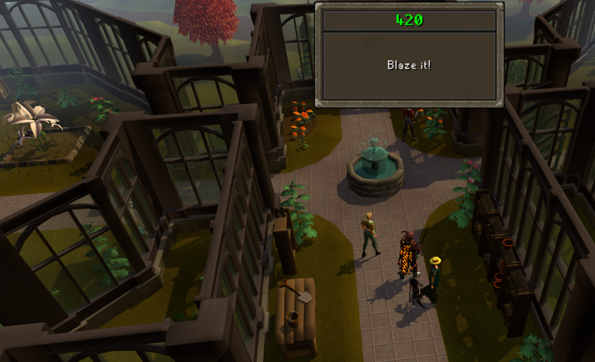
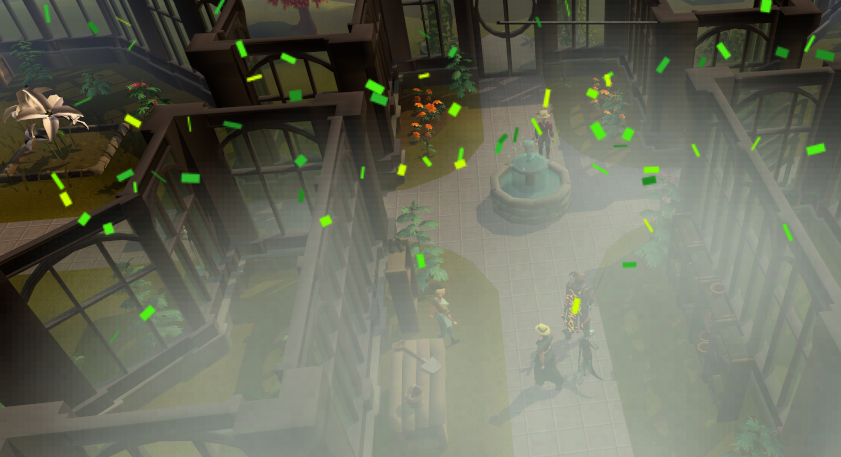
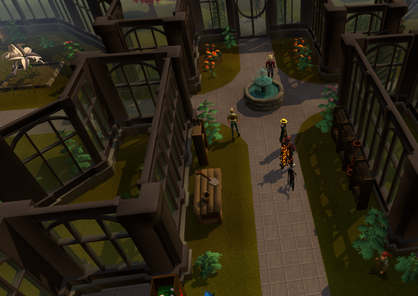
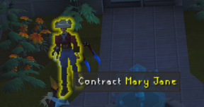
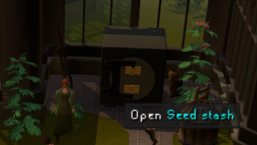

# 420 kc

`420 kc` celebrates when tracked boss, activity, and clue counts reach 420, and grows hemp in the Farming Guild on
worlds 420 to 422.

## Celebrations

- Detects when a tracked count hits exactly 420: boss kill counts, raid and activity completions, and clue scroll totals
- Sends a celebratory message in chat
- Shows the game's collection log popup: 420, Blaze it!
- Rolls smoke over the game screen and drops green confetti, each with its own density and duration
- Type ::420 in chat to see your celebration as it's set

## Farm Guild

- The guild's trees and bushes grow hemp, the game's own plant
- More hemp: the guild's plain crates grow hemp too; the crates you can search stay crates
- Growth stage: every plant its own stage each time the guild loads (Random), or any one of the five stages
- Grow at 4:20: at 4:20 pm your time, every plant grows a stage
- Guildmaster Jane is Mary Jane, in her right-click options, over her dialogue and in many of her lines
- The seed vault is the Seed Stash
- Shows on worlds 420 to 422 only, unless you turn that off: 420 needs 1,500 total level, and 421 and 422 are open to
  every members account

Every feature has its own switch in plugin settings, and all of them start on. Only you see the Farm Guild; turning it
off brings the game's own guild back. The hemp is scenery: it can't be clicked or examined.
